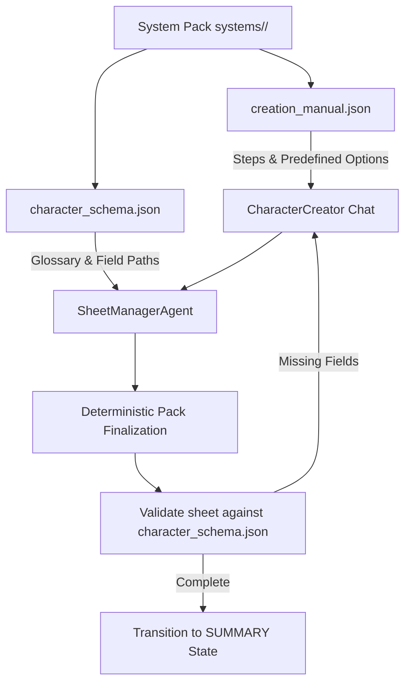
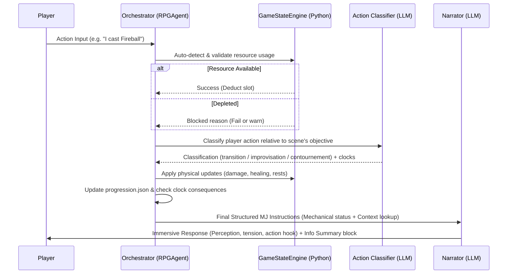

# 🎲 RPG Oracle - Multi-Agent RAG System

RPG Oracle is an advanced, ruleset-agnostic Tabletop Role-Playing Game (TTRPG) assistant. Powered by a multi-agent architecture and Retrieval-Augmented Generation (RAG), it orchestrates everything from dynamic character creation to complex narrative management, deterministic state progression tracking, and pure mechanical enforcement.

---

## 🏗 Architecture & Agents

The system uses specialized agents, each with dedicated prompts, LLM configurations, and clear responsibilities to split creative storytelling from rigorous rules enforcement.

### 1. The Orchestrator (`RPGAgent`)
*   **Role**: The "Brain" of the system. It handles state transitions (`CREATION` → `SUMMARY` → `ADVENTURE`), triggers technical rules analysis, and coordinates all sub-agents.
*   **Key Functions**:
    *   Determines when a roll or action is needed based on rules.
    *   Runs a pre-narrative **3-branch Player Action Classifier** (transition, improvisation, or contournement/bypass) in `ADVENTURE` mode to deterministically update active scenes/acts.
    *   Integrates the `GameStateEngine` to validate actions and apply consequences (damage, healing, XP, clock progress) before instructing the Narrator.
    *   Uses a factorized narrative builder to instruct the Narrator on exactly what facts to describe and what mechanical parameters are active.

### 2. Character Creator (`CharacterCreator`)
*   **Role**: Guides the player step-by-step through the ruleset-specific character building process.
*   **Key Functions**:
    *   Operates purely in narrative mode (does not output technical JSON directly) to maintain an immersive experience.
    *   Prepend the previous Master response to the user's input to enrich RAG queries and prevent conversational drift.
    *   Acts in tandem with the Sheet Manager to decouple raw chat interaction from structured technical data extraction.

### 3. The Narrator (`Narrator`)
*   **Role**: The "Voice" of the Game Master. Translates dry technical state changes into rich, atmospheric storytelling.
*   **Key Functions**:
    *   Enforces a strict narrative prompt: writes in the second person ("You"), never uses bullet points or numbering in its storytelling, and never decides rules or interprets player intent.
    *   Concludes every turn with a strict text block: `--- \n 📌 Résumé des informations`, which must report only facts explicitly stated in the narrative block.

### 4. Sheet Manager (`SheetManagerAgent`)
*   **Role**: Audits and maintains the character sheet in real-time.
*   **Key Functions**:
    *   Decoupled from the direct narrative flow of character creation. When end-phrases or state changes are detected, it runs an `audit_and_complete` pass on the conversational history to extract missing fields.
    *   Updates experience points, items, and inventory based on storyline event transitions.

### 5. Chronicle Agent (`ChronicleAgent`)
*   **Role**: The historian. Maintains a factual, concise chronicle of the adventure.
*   **Key Functions**:
    *   Updates `Memory/Chronicle.json` after every player action.
    *   Records clock consequences, major milestones, and `notable_deviation` as part of the persistent log.

### 6. Setup Agent (`ScenarioExtractorAgent`)
*   **Role**: Unified scenario compiler.
*   **Key Functions**:
    *   Processes PDF adventure modules via a 5-pass sequential extraction (Entities, Scene Nodes, Macro-structure, Global Clocks, and Metadata).
    *   Generates the deterministic reference file `Memory/scenario_structure.json`.

---

## 🎲 Deterministic System Packs (Pure Python Resolution)

To completely eliminate LLM hallucinations during gameplay, RPG Oracle uses **System Packs** for mechanical resolution. Instead of dynamically extracting mechanics from PDFs using LLMs, the system relies on structured, strictly validated configuration files (JSON/YAML) and a pure Python resolution engine.

### Core Families
The engine supports multiple generalized rule "Families", configuring how dice are rolled and successes are evaluated. Currently supported families:
*   **`D20VsTarget`**: Roll a d20 + modifiers against a difficulty target (e.g., D&D 5e). Supports advantage/disadvantage and criticals.
*   **`PbtA2d6`**: Roll 2d6 + modifiers against defined tiers (e.g., Powered by the Apocalypse: 6-, 7-9, 10+).
*   **`StepTargetD20`**: Roll a d20 against a target calculated from a difficulty modified by step adjustments (e.g., Cypher System).
*   **`DicePoolSuccess`**: Roll a pool of dice, count results above a threshold as successes. Supports botches.

### Creating a System Pack
You can bootstrap a new system pack automatically using the built-in CLI template generator.

```bash
# Generate a boilerplate for a D20VsTarget game
python -m systems.new my_d20_game --family D20VsTarget

# Generate a boilerplate for a PbtA game
python -m systems.new my_pbta_game --family PbtA2d6
```

This creates a new folder `systems/<id>/` containing three required files:
1.  `manifest.yaml`: Metadata (name, language, version).
2.  `resolution.json`: The specific parameters for your chosen dice family.
3.  `resources.json`: Definitions of pools (like HP, spells) and recovery triggers.

Fields that require your input are pre-filled with the literal string `"TODO"`.

### Validation & CI
You must fill out the `"TODO"` fields to complete your pack. To verify that your pack is structurally sound (including advanced checks like missing tiers or overlaps in PbtA), use the validation CLI:

```bash
# Validate your custom pack
python -m systems.validate systems/my_d20_game

# Use --strict to treat "TODO" fields and warnings as failures
python -m systems.validate systems/my_d20_game --strict
```

---

## ⚡ Pack-Driven Character Creation & Validation

Traditional TTRPG digital assistants are hardcoded to specific systems. RPG Oracle is **ruleset-agnostic**, relying on each System Pack's `creation_manual.json` and `character_schema.json`:



1.  **Pack Creation Manual (`creation_manual.json`)**: Defines the ordered creation steps (`steps`), global system rules (`general_rules`), and structured catalogs of predefined character options (`options`, such as Cypher Types/Descriptors/Foci or D&D 5e Races/Classes) with their mechanical effects and bonuses.
2.  **Pack Character Schema (`character_schema.json`)**: Defines `required_fields` (with dot-notation paths and sub-fields), a `glossary` injected into `CharacterCreator` and `SheetManagerAgent` prompts so the LLM writes to the exact paths expected by the engine, and `defaults` applied deterministically.
3.  **Two-Step Decoupled Creation & Deterministic Finalization**:
    *   `CharacterCreator` guides the player narratively in French using the pack's manual and glossary.
    *   `SheetManagerAgent` updates the structured JSON sheet after each turn and runs `audit_and_complete` when creation concludes.
    *   `_finalize_pack_character()` deterministically normalizes resource pools (`total` → `max`, `restants` → `current`, sets `current = max` when missing/0) and applies `character_schema.defaults` without any extra LLM call.
4.  **Schema-Based Validation**: The Orchestrator calls `validate_character_sheet()` against the pack's `character_schema.json`. Once all required fields are present, the state transitions cleanly to `SUMMARY`.

---

## ⚙️ Game State Engine (Pure Python / Zero LLM)

To guarantee mechanical integrity and prevent LLM hallucinations, RPG Oracle separates narration from mathematics. The `GameStateEngine` (`game_state_engine.py`) is a pure-Python, zero-LLM engine that acts as the absolute source of truth for stats and resources.

### Key Capabilities
*   **Resource Tracking**: Manages health pools, XP, consumable pools, and structured pool groups (such as spell slots `level_1` to `level_9`).
*   **Automatic Action Detection**: Analyzes player input against localized trigger rules in `triggers.json` to consume resources or trigger recovery sequences before generating narrative responses.
*   **Derived Stat Recalculation**: `synchronize_and_recalculate()` keeps sheet values consistent and only normalizes `resources.hit_points` if the active pack explicitly manages `resources.hit_points`, preserving system-specific pool structures (such as Cypher's `might`, `speed`, and `intellect`).
*   **System Packs (`systems/<id>/`)**: Configured via `SYSTEM_PACK=<id>` in `.env`. Built-in packs include `cypher_system` and `dnd5e_srd`.
    *   **Formula & Pooled Recovery**: Supports `full`, `fixed`, `percent`, and `formula` recovery modes (evaluated safely via `mechanics/expr.py` with `character` and `pool` context), as well as `pooled_recoveries` (shared recovery rolls allocated by the player across pools) and `recovery_sequences` (such as Cypher's 4-step daily rest cycle).
    *   **Actions (`actions.json`)**: Supports task actions (e.g. attack, defend, climb) with dynamic effort mechanics and difficulty scales. `execute_task(action_id, pool_id, difficulty, step_adjustments, effort_levels, impaired)` evaluates cost formulas (using `effort.levels`, `effort.edge`, and `effort.impaired`), verifies resources atomically, resolves the check, and returns an `ActionResult` with structured `state_changes`.
*   **Task Flow & State Guard (`mechanics/task_flow.py`)**: Provides prompt builders, decision sanitizers, narrative outcome formatters, and `enforce_engine_owned_fields()` to prevent the Sheet Manager LLM from overwriting engine-managed pools and state paths.

---

## 📂 Scenario Reference & State Models

RPG Oracle manages adventure progression deterministically, keeping static plot structures separated from the active session state.

### 1. `Memory/scenario_structure.json`
Acts as the static scenario blueprint. No RAG is performed on this file.
```json
{
  "metadata": {
    "titre": "Nom du scénario",
    "pitch_global": "Résumé de l'intrigue en 2 sentences.",
    "scene_initiale": "SCENE_01_DEPART"
  },
  "macro_structure": [
    {
      "id_acte": "ACTE_1",
      "titre": "Titre",
      "condition_entree": "...",
      "condition_validation": "...",
      "scenes_incluses": ["SCENE_01_DEPART"]
    }
  ],
  "horloges_globales": [
    {
      "nom": "Nom de la menace",
      "declencheur": "Chasse ou temps",
      "consequence": "Le donjon s'effondre",
      "seuil": 6
    }
  ],
  "entites": {
    "pnj": [
      {
        "id": "PNJ_ELROND",
        "nom_complet": "Maître Elrond",
        "localisation_habituelle": "LIEU_FONDCOMBE",
        "agenda_et_motivation": "Aider les PJ",
        "peurs_et_faiblesses": "La perte de l'anneau",
        "attitude_initiale": "Bienveillant",
        "stats_et_capacites": "Inconnu"
      }
    ],
    "lieux": [
      {
        "id": "LIEU_FONDCOMBE",
        "nom_complet": "Fondcombe",
        "ambiance_sensorielle": "Chant de cascades et vent doux",
        "elements_interactifs": "Lore Books"
      }
    ]
  },
  "noeuds_sceniques": [
    {
      "id_scene": "SCENE_01_DEPART",
      "acte_rattache_id": "ACTE_1",
      "lieu_rattache_id": "LIEU_FONDCOMBE",
      "titre": "Rencontre",
      "pnj_presents": ["PNJ_ELROND"],
      "objectif_mj": "Expliquer le but",
      "condition_resolution": "Le PJ accepte la quête",
      "limites_et_regles_locales": "...",
      "defis_et_rencontres": [],
      "sorties_logiques": [
        {
          "action_ou_direction": "S'engager dans la forêt",
          "destination_scene_id": "SCENE_02_FORET"
        }
      ]
    }
  ]
}
```

### 2. `Memory/progression.json`
Tracks the active progression state of the running adventure session.
```json
{
  "acte_courant": "ACTE_1",
  "scene_courante": "SCENE_01_DEPART",
  "scenes_resolues": [],
  "scenes_contournees": [],
  "horloges": {
    "Nom de la menace": {
      "segments": 0,
      "declenchee": false
    }
  },
  "ecarts_notables": []
}
```

---

## 🛠️ Scenario Loading & Self-Healing Pipeline

During world setup (`setup_world()`), the system ensures scenario files are clean, valid, and highly optimized:

### 1. Source Detection
The orchestrator scans `data/scenario/` for resources:
*   **Single JSON File**: Directly loads and validations the file as the blueprint.
*   **Multiple JSON Files**: Raises a `ValueError` to prevent session collisions.
*   **No JSON Files (PDFs only)**: Begins the 5-pass extraction using `ScenarioExtractorAgent`.

### 2. Static Validation & Self-Healing
Every loaded scenario runs through a strict validation suite in `validation.py` before execution starts:
*   **Orphan Cleanups**: Replaces invalid PNJ, scene, or place references with `null` or removes them with warning logs.
*   **Bidirectional Act-Scene Alignment**: Auto-synchronizes scenes pointing to acts and acts listing scenes, correcting missing cross-references dynamically.
*   **Duplicate ID Detection**: Detects duplicated entity or scene IDs across collections to prevent silent state overrides.
*   **Seuil Defaulting**: Missing global clock thresholds auto-heal to a default of `6`.
*   **Blocking Validation**: If critical fields (like `condition_resolution` or `acte_rattache_id`) are missing, the validator halts initialization and flags a manual fix or re-extraction.

### 3. Full-Text Bypass Optimization
Standard RAG similarity searches can fail to resolve context for shorter modules. If a scenario's concatenated text length is under `SCENARIO_FULLTEXT_THRESHOLD_CHARS` (default: `40000`), the extractor **bypasses semantic search completely**, feeding the complete raw text directly to all extraction passes to guarantee absolute structural context.

---

## 🔄 Core Gameplay Loop (Adventure Mode)



### Fichiers optionnels de création de personnage
Les packs système peuvent inclure des fichiers optionnels (strictement validés par `validate_pack` et chargés par `systems.loader`) pour configurer la création de personnage :
- `character_schema.json` : Définit la structure attendue de la fiche de personnage et assure la validation dynamique.
- `creation_manual.json` : Guide étape par étape la logique du processus de création de personnage en isolant cette connaissance du LLM.

La méthode `synchronize_and_recalculate` du moteur a été mise à jour : la normalisation historique des "hit_points" ne s'applique désormais qu'aux packs définissant explicitement un pool d'id `hit_points`, et préserve intactes les structures de PV spécifiques aux autres systèmes (comme Cypher System).

### Mode tâche (packs avec actions.json)

Lorsque le `SYSTEM_PACK` spécifié possède un fichier `actions.json` valide **ET** que la famille de résolution est `StepTargetD20`, le `GameStateEngine` gère entièrement la résolution mécanique des actions des joueurs (Task Mode) :
- **Analyse de tâche :** L'Orchestrateur détermine si l'action nécessite un jet en fournissant un JSON normalisé avec l'action choisie, la réserve, la difficulté et les ajustements (avantages ou obstacles).
- **Résolution déterministe :** Le moteur Python exécute la tâche en appliquant les coûts (effort), effectue les calculs, vérifie la capacité du personnage et génère un rapport technique incontestable.
- **Narration forcée :** Le LLM narratif reçoit des instructions l'obligeant à s'appuyer exclusivement sur le rapport technique.
- **Garde-fou des états :** Si le mode tâche ou les actions de l'Orchestrateur tentent de modifier l'état ou la progression mécanique du personnage de manière incohérente avec le modèle (ex: triche sur les ressources en cours de tour, altérations sur les variables sous la tutelle exclusive du moteur), un mécanisme de validation et de correction (safeguard) annule ces écritures. Les variables réservées sont rechargées de force dans la fiche avant d'être écrites, préservant ainsi la pureté des statistiques du système.
> **Note :** La gestion des dégâts automatiques et du système de repos Cypher System n'est pas encore implémentée de manière entièrement procédurale dans le mode tâche actuel.

### Détection d'actions du pack

Le `GameStateEngine` intercepte de façon transparente les intentions des joueurs en croisant leurs requêtes avec les mots-clés du pack (via `triggers.json`).
- **Consommations (Consume) :** Déduit instantanément des réserves sans faire appel au LLM (ex: sorts, munitions).
- **Repos et Séquences (Recover) :** Gère la régénération des ressources selon des règles configurables (formules, dés), des limites maximales, ou via une suite d'étapes de repos séquentielles (ex: Cypher System).
- **Répartition en attente (Allocation) :** Lorsque les règles de récupération prévoient un gain au choix du joueur sur plusieurs réserves, le moteur bloque la boucle normale et consigne une `pending_allocation`. Au tour suivant :
  - **Allocate :** Le joueur répartit ses points, le moteur met à jour la fiche.
  - **Decline :** Le joueur refuse, les points sont perdus.
  - **Non comprise :** Si l'intention est floue, le moteur redemande poliment de clarifier, empêchant tout avancement abusif ou hors-sujet.

---

## 📚 Scenario RAG & Indexing

RPG Oracle uses ChromaDB to index adventure scenarios (`data/scenario/`) while system rules are handled deterministically through System Packs (`systems/<id>/`).

### Directory Structure
*   `systems/<pack_id>/`: System Pack definitions (`manifest.yaml`, `resolution.json`, `resources.json`, `triggers.json`, `actions.json`, `character_schema.json`, `creation_manual.json`).
*   `data/scenario/`: Place PDFs or structured JSON files containing adventure modules and scenarios.

### Using the Indexer
Run `indexer.py` to index scenario documents or extract a draft system pack from rulebook PDFs:
```bash
# Index scenario documents
python indexer.py

# Wipe Chroma DB, clear Memory/, and re-index scenario documents
python indexer.py --reset

# Index scenario documents only
python indexer.py --scenario

# Extract a draft system pack from rulebook PDFs
python indexer.py --pack my_system --pdf path/to/rules.pdf
```

---

## ⚙️ Configuration (.env)

Adjust settings and models individually per agent:

| Variable | Description |
| :--- | :--- |
| `SYSTEM_PACK` | **Required.** The ID of the system pack to load from `systems/` (e.g. `cypher_system`, `dnd5e_srd`). |
| `LLM_PROVIDER` | `ollama`, `openai`, `anthropic`, or `gemini` (Google) |
| `LLM_REASONING` | Enable reasoning for all agents (`true`, `false`, `default`). Optional. |
| `LLM_KEEP_ALIVE` | Duration to keep the model loaded in Ollama (e.g. `30m`). Optional. |
| `PACK_NUM_CTX` | Context window size for `PackExtractorAgent` (default: 32768) |
| `PACK_NUM_PREDICT` | Output token limit for `PackExtractorAgent` (default: 16384) |
| `PACK_REASONING` | Enable reasoning specifically for `PackExtractorAgent` (default: `false`). |
| `PACK_EXTRACTOR_TEMP` | Temperature specifically used by `PackExtractorAgent` (default: 0.1) |
| `EMBEDDING_PROVIDER` | `ollama`, `openai`, or `gemini` |
| `LLM_MODEL` | Default fallback model name |
| `OPENAI_API_KEY` | OpenAI API key (required if using `openai` provider) |
| `ANTHROPIC_API_KEY` | Anthropic API key (required if using `anthropic` provider) |
| `GEMINI_API_KEY` | Google Gemini API key (required if using `gemini` provider) |
| `CHARACTER_MODEL` | Model for character creation |
| `NARRATOR_MODEL` | Model for narrative prose |
| `ORCHESTRATOR_MODEL` | Model for GM state and task logic |
| `RAG_SEARCH_K` | Number of scenario chunks to retrieve (default: 12) |
| `SCENARIO_FULLTEXT_THRESHOLD_CHARS` | Threshold under which the full scenario text is processed directly (default: 40000) |
| `SERVER_PORT` | Streamlit server port (default: 8501) |

---

## 🚀 Getting Started

### Prerequisites
*   **Python 3.9 to 3.13** (Note: Python 3.14+ is currently unsupported due to ChromaDB dependencies).
*   An LLM backend (Ollama, llama.cpp, or OpenAI compatible APIs).

### Installation
1.  Install pinned dependencies:
    ```bash
    python -m pip install -r requirements.txt
    ```
2.  Setup environment variables:
    ```bash
    cp .env.example .env
    # Edit .env to set your LLM providers and models
    ```
3.  Index system files:
    ```bash
    python indexer.py
    ```
4.  Run the application:
    ```bash
    python run.py
    ```

---

## 💾 Session Management & Save States
Session state is written to the `Memory/` directory:
*   `character.json`: Current active character sheet.
*   `scenario_structure.json`: Loaded static structural scenario reference.
*   `progression.json`: Active campaign progression, completed scenes, and horloges.
*   `Chronicle.json`: Running story and narrative timeline.

*   **Resetting Session**: Calling `clear_history()` resets the active session by deleting `character.json`, `Chronicle.json`, and `progression.json`, while **preserving** `scenario_structure.json` as a static reference blueprint.
